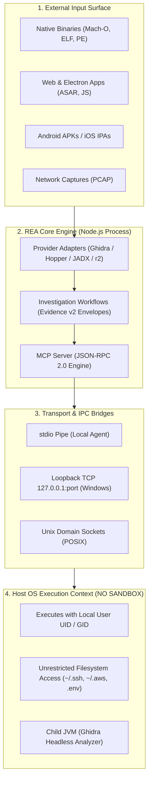

# 01 - REA Internal Architecture Deep Dive

## 1. Executive Architectural Overview
`morluto/rea` (Reverse Engineer Anything) is distributed as an npm package (`rea-agents`) that acts as a **Model Context Protocol (MCP)** server. Its primary objective is bridging autonomous AI coding agents (Claude Code, Cursor, Codex, Gemini CLI) directly to native reverse-engineering tools, disassemblers, decompilers, and runtime debuggers.

While the tool claims to empower developers to understand complex software, its underlying architecture bypasses foundational host security boundaries.



---

## 2. Inward-Flowing Dependency Model
REA organizes its codebase around a clean architectural model where dependencies flow strictly inward:
1. **External Layer (`src/adapters`):** Implements connectors to external tools:
   - `ghidra-adapter`: Launches headless Ghidra scripts via Java JVM.
   - `hopper-adapter`: Interfaces with Hopper v4 disassembler.
   - `jadx-adapter`: Invokes JADX for decompiling Android DEX files.
   - `electron-adapter`: Unpacks ASAR archives and formats JavaScript bundles.
2. **Workflows Layer (`src/workflows`):** Aggregates raw disassembly and string dumps into structured JSON envelopes called **`Evidence v2`**.
3. **Core Domain (`src/core`):** Declares tool schemas, parameter validation, and result data structures.
4. **Server Layer (`src/server`):** Implements the MCP protocol spec, listening for incoming JSON-RPC tool calls from the AI coding agent.

---

## 3. The 130+ Tool Inventory & Attack Surface Exposure
REA exposes over **130 distinct MCP tools** directly into the AI agent's execution registry. These tools fall into six functional categories:

| Category | Representative Tools | Execution Mechanism | Host Privilege Impact |
|:---|:---|:---|:---|
| **Binary Disassembly** | `disassemble_function`, `decompile_function`, `get_xrefs` | Spawns headless Ghidra / Hopper CLI | High CPU/RAM consumption; executes local native binaries |
| **String & Symbol Extraction** | `extract_strings`, `get_import_table`, `get_export_table` | Direct file read & binary parsing | Direct pipe into LLM context window (IPI injection surface) |
| **Control Flow Analysis** | `build_cfg`, `calculate_cyclomatic_complexity`, `trace_callgraph` | In-memory graph generation | Memory exhaustion on obfuscated control flow |
| **Electron & Web Inspection** | `unpack_asar`, `beautify_bundle`, `extract_sourcemap` | Node.js filesystem modules | Unpacks arbitrary archive files on host disk |
| **Android APK Decompilation** | `jadx_decompile`, `extract_android_manifest` | Spawns Java JADX runtime | Unpacks APK zip structures; parses untrusted XML |
| **Process & Runtime Debugging** | `inspect_process_memory`, `list_open_sockets`, `trace_syscalls` | Native OS APIs (`ptrace`, `VirtualQueryEx`) | Inspects running processes of the logged-in user |

---

## 4. Transport, IPC & The Capability Token Flaw

### 4.1 Transport Selection Mechanics
REA allows AI agents to connect via two primary transports:
1. **Standard I/O (`stdio`):** The AI coding assistant launches `npx rea-agents mcp` as a subprocess and communicates via standard input/output.
2. **Network / Socket Transport:** Used when coordinating across separate debugger processes:
   - **POSIX (Linux/macOS):** Unix domain sockets created under `/tmp/rea-<uuid>.sock` with mode `0600`.
   - **Windows:** Loopback TCP socket bound to `127.0.0.1:<random_port>`.

### 4.2 The Capability Token Vulnerability
To authenticate internal IPC requests on Windows, REA generates a pseudo-random session token:
```typescript
/**
 * REA Capability Token Generation (Conceptual Implementation)
 */
import { randomBytes } from 'crypto';

export class TokenManager {
  private readonly sessionToken: string;

  constructor() {
    this.sessionToken = randomBytes(32).toString('hex');
  }

  public validate(incomingToken: string): boolean {
    return incomingToken === this.sessionToken;
  }
}
```

#### Why This Token Provides Zero Real Security on a Host Workstation:
1. **Same-User Process Visibility:** Under Windows security architecture, any process running under the same user security identifier (SID) can query the process environment table using `OpenProcess(PROCESS_QUERY_INFORMATION | PROCESS_VM_READ)`:
   - A concurrent background process (e.g. an infostealer, a rogue VS Code extension, or an untrusted Electron app) can read the command-line arguments and environment variables of the REA process, instantly recovering the token.
2. **Loopback Traffic Snooping:** Because the loopback TCP interface (`127.0.0.1`) is shared across all processes in the same network namespace, any local process can initiate a connection to the port. If token validation is delayed or flawed, unauthorized local processes can issue arbitrary tool calls against REA.

---

## 5. Host Process Privilege Hierarchy & The "No Sandbox" Vulnerability

The most dangerous aspect of REA is the complete absence of kernel isolation.

```
Operating System Kernel (Ring 0)
└── Host User Session (Ring 3: e.g., UID 1000 / techd)
    ├── Primary IDE / Terminal (Claude Code, Cursor, VS Code)
    │   └── Child Process: Node.js (npx rea-agents)
    │       ├── Child Process: OpenJDK JVM (Ghidra headless analyzer)
    │       ├── Child Process: Hopper Disassembler / radare2
    │       └── Child Process: JADX Android Decompiler
    │
    └── Access Rights Inherited by ALL Child Processes:
        ├── Read/Write: C:\Users\techd\.ssh\id_rsa
        ├── Read/Write: C:\Users\techd\.aws\credentials
        ├── Read/Write: C:\Users\techd\.gitconfig & personal access tokens
        ├── Read/Write: All project workspaces & .env secret files
        └── Network: Outbound internet connectivity (HTTP/HTTPS/DNS/TCP)
```

### The Architectural Failure:
REA relies entirely on the developer's operating system permissions. It assumes that because the user *asked* to analyze a file, the file and all generated decompiler outputs are benign.

If an analyzed binary triggers an exploit in Ghidra's parser, or if an indirect prompt injection hijacks the AI agent, the resulting execution occurs with **100% of the user's rights**, requiring zero privilege escalation to wipe data, steal secrets, or install persistence.
