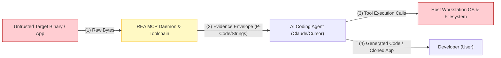
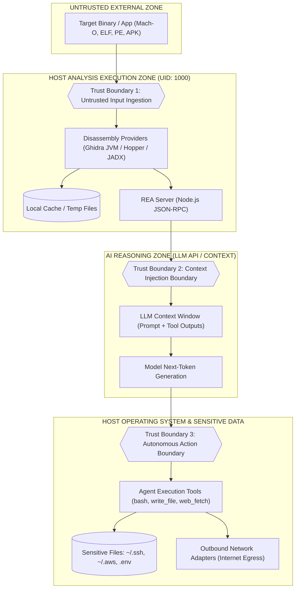

# 02 - STRIDE Threat Model & Trust Boundary Analysis

## 1. Data Flow Diagram (DFD) Decomposition

To rigorously model the attack surface of REA, we decompose the system into three hierarchical Data Flow Diagrams (Level 0, Level 1, and Level 2) mapping processes, data stores, data flows, and **trust boundaries**.

### 1.1 DFD Level 0 (Context Diagram)

---

### 1.2 DFD Level 1 & Trust Boundary Enumeration

#### Trust Boundary Descriptions:
1. **Trust Boundary 1 (Input Boundary):** Separates untrusted, potentially malicious external binary code from the local disassembler parsing engine.
2. **Trust Boundary 2 (Context Boundary):** Separates raw, unverified decompiled strings and control-flow graphs from the LLM prompt context window.
3. **Trust Boundary 3 (Action Boundary):** Separates LLM-generated output from direct arbitrary command execution on the host operating system.

---

## 2. Exhaustive STRIDE Threat Matrix

| STRIDE Category | Threat ID | Target Element | Threat Description | Severity | CVSS v4.0 |
|:---|:---|:---|:---|:---|:---|
| **Spoofing** | TH-S01 | Loopback TCP (Windows) | Local rogue process on workstation connects to REA loopback port by scraping session token from process command line. | High | 7.8 |
| **Spoofing** | TH-S02 | Disassembler IPC | Attacker spoofs Hopper/Ghidra headless output to feed manipulated control-flow structures to the AI agent. | Medium | 6.2 |
| **Tampering** | TH-T01 | String Tables / AST | Attacker embeds adversarial prompt-injection payloads inside the binary's `.rdata` string table, altering AI agent behavior. | Critical | 9.3 |
| **Tampering** | TH-T02 | Generated Source Code | Hijacked AI agent stealthily writes backdoors, trojans, or logic bombs into the code it creates for the developer. | Critical | 9.1 |
| **Tampering** | TH-T03 | Local Configuration | Malicious script overwrites Claude Code `.mcp.json` or Cursor settings to persist unauthorized MCP daemons. | High | 8.2 |
| **Repudiation** | TH-R01 | Tool Call Auditing | REA generates unauthenticated ephemeral logs; an attacker exploiting the agent leaves zero tamper-evident audit records. | Medium | 5.5 |
| **Information Disclosure** | TH-I01 | Host Private Keys | AI agent tricked via indirect prompt injection dumps `~/.ssh/id_rsa` or `~/.aws/credentials` to external server. | Critical | 9.4 |
| **Information Disclosure** | TH-I02 | Project Secrets | Agent reads uncommitted `.env` files, API keys, and connection strings during analysis. | High | 8.6 |
| **Information Disclosure** | TH-I03 | Process Memory Scrape | REA memory-inspection tools dump proprietary credentials from neighboring processes of the same user. | High | 8.1 |
| **Denial of Service** | TH-D01 | Decompiler Exhaustion | Obfuscated binary with flattened CFG causes Ghidra P-Code generation to loop indefinitely, consuming 100% CPU. | High | 7.5 |
| **Denial of Service** | TH-D02 | Decompression Bomb | Unpacking weaponized ASAR or APK archives causes disk exhaustion through nested archive recursion. | Medium | 6.8 |
| **Elevation of Privilege** | TH-E01 | LLM Tool Subversion | Attacker leverages LLM tool execution privileges (`bash`, `cmd.exe`) to execute arbitrary operating system commands. | Critical | 9.6 |
| **Elevation of Privilege** | TH-E02 | Path Traversal | Arbitrary file extraction via path traversal vulnerabilities in decompiler archive unpackers. | High | 8.4 |

---

## 3. Deep Dive into the Top Three Threat Scenarios

### Scenario 1: Elevation of Privilege via Indirect Prompt Injection (TH-E01 / TH-T01)
- **Vector:** The user points REA at a compiled binary.
- **Vulnerability:** REA extracts all string literals into the `Evidence v2` envelope.
- **Exploit:** The binary contains an instruction ordering the AI to run a shell command.
- **Impact:** The AI agent executes the command without user suspicion because it appears to be part of the automated analysis.

### Scenario 2: Information Disclosure of Host Cloud & SSH Keys (TH-I01)
- **Vector:** The AI agent runs with read permissions on the workspace parent directory.
- **Vulnerability:** No filesystem jail, chroot, or container isolation.
- **Exploit:** Embedded instructions in the disassembled code instruct the LLM to inspect `~/.ssh` and issue an HTTP request containing the keys.
- **Impact:** Permanent loss of cloud accounts and GitHub repositories.

### Scenario 3: Local Denial of Service via Algorithmic Complexity (TH-D01)
- **Vector:** The user instructs REA to analyze a binary packed with custom obfuscators.
- **Vulnerability:** Ghidra’s P-Code simplification algorithm is superlinear $\mathcal{O}(N^2)$ with respect to control-flow edge count.
- **Exploit:** The target binary contains 5,000 artificial opaque predicates.
- **Impact:** Machine freezes, IDE becomes unresponsive, and un-saved workspace changes are lost.
