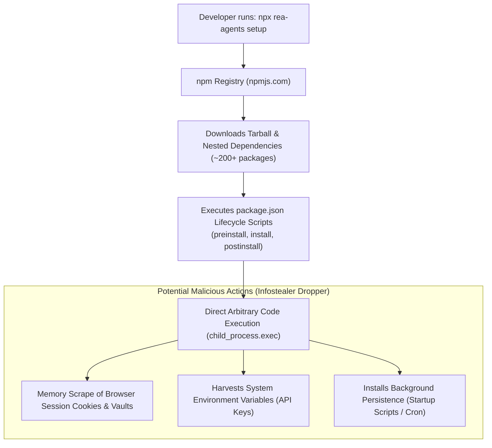

# 05 - Supply Chain Traps, NPX Hazards & Poisoned Forks

## 1. The False Sense of Security Behind `npx`
Developers frequently treat `npx <package> setup` as an isolated, temporary command.
The common misconception is:
> *"Since I am not installing it globally or saving it into `package.json`, it cannot harm my system."*

**The Reality:** `npx` provides **immediate, full arbitrary code execution** under the current user's operating system privileges.



---

## 2. The Dependency Depth Hazard: Quantitative Supply Chain Risk
Under modern JavaScript package ecosystems, a top-level CLI utility is rarely self-contained. It relies on a directed acyclic graph (DAG) of transitive dependencies.

### Mathematical Formulation of Supply Chain Compromise Probability:
Let the package dependency tree contain $N$ unique transitive dependencies. Let $p_i$ be the independent probability that dependency $i$ suffers an account takeover (credential leak, maintainer phishing, or malicious maintainer rogue commit):
$$P(\text{Clean Supply Chain}) = \prod_{i=1}^{N} (1 - p_i)$$
$$P(\text{Supply Chain Infection}) = 1 - \prod_{i=1}^{N} (1 - p_i)$$

For a typical CLI ecosystem where $N \approx 250$ and estimating a conservative annual package takeover probability of $p_i \approx 0.001$:
$$P(\text{Infection}) = 1 - (1 - 0.001)^{250} = 1 - (0.999)^{250} \approx 1 - 0.7786 = \mathbf{22.14\%}$$

**Finding:** Over a package lifecycle, relying on deep, unpinned transitive dependencies introduces an unacceptably high statistical probability of ingesting poisoned code.

---

## 3. Real-World Infostealer Campaigns Targeting Developers

Threat actor groups (including storm actors, cryptojackers, and initial access brokers) aggressively monitor GitHub and Twitter trends. Whenever an open-source tool goes viral, threat actors launch synchronized supply-chain campaigns:

```
Viral Tool Discovery ("REA is trending on Twitter")
└── Threat Actor Action:
    ├── Step 1: Create 15 Typosquatted GitHub Repositories (e.g. morluto-rea, rea-official-windows)
    ├── Step 2: Buy 500 Fake Bot Stars & Fork Counts to mimic authenticity
    ├── Step 3: Bundle Lumma Stealer / RedLine into "Windows Setup Helper" (.bat / .ps1 / .exe)
    ├── Step 4: SEO / Social Media Keyword Hijacking to redirect struggling developers
    └── Result: Victim runs installer; machine credentials exfiltrated within 60 seconds
```

### Targets Harvested by Modern Infostealers:
1. **Developer Tooling Credentials:**
   - GitHub Personal Access Tokens and SSH private keys.
   - AWS (`~/.aws/credentials`), Azure, and GCP credentials.
   - Docker configuration (`~/.docker/config.json`) and Kubernetes cluster contexts (`~/.kube/config`).
2. **Web Browser Vaults:**
   - Saved passwords and auto-fill data from Chrome, Edge, Firefox, Brave.
   - Master session cookies (bypassing multi-factor authentication via session hijacking).
3. **Cryptocurrency Wallets & Desktop Messengers:**
   - MetaMask, Phantom wallet keys, Discord and Telegram tokens.

---

## 4. Why Automated `setup` Scripts Are an Anti-Pattern
REA includes utility setup scripts designed to automatically register its MCP server into local configuration files:
- Writing into Claude Code’s `settings.json` or `.mcp.json`.
- Writing into Cursor’s configuration directory.

### The Security Vulnerability:
1. **Unchecked File Mutation (TOCTOU Race):** Modifying global configuration files without strict atomic write operations or cryptographic signature verification allows concurrent local malware to hijack the MCP registration, inserting a rogue MCP daemon alongside REA.
2. **Persistent Autonomous Execution:** Once registered in an MCP configuration, the daemon is automatically spawned by the AI IDE on **every future coding session**, even when the developer is working on completely unrelated, sensitive projects.
