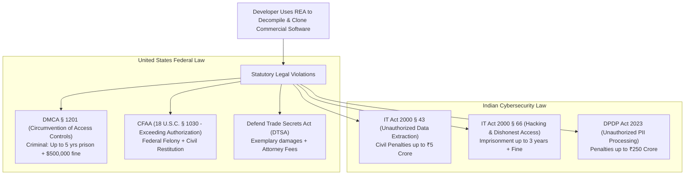

# 06 - Legal, Regulatory & Clean-Room Forensic Assessment

## 1. Statutory Penalties: The Criminal & Civil Reality

Developers frequently share videos online showcasing AI-driven reverse-engineering under the impression that software reverse-engineering is universally legal under "fair use". 
**This is legally and historically incorrect.**

---

## 2. United States Federal Statutes

### 2.1 Digital Millennium Copyright Act (17 U.S.C. § 1201)
Section 1201(a)(1) states:
> *"No person shall circumvent a technological measure that effectively controls access to a work protected under this title."*

- **Circumvention Tools Ban (§ 1201(a)(2)):** Prohibits manufacturing, importing, offering to the public, or providing any technology, product, service, device, or component that is primarily designed or produced for the purpose of circumventing protection measures.
- **Criminal Penalties (17 U.S.C. § 1204):**
  - First offense: Fine of up to **$500,000** or imprisonment for up to **5 years**, or both.
  - Subsequent offenses: Fine of up to **$1,000,000** or imprisonment for up to **10 years**, or both.

### 2.2 Computer Fraud and Abuse Act (18 U.S.C. § 1030)
Using reverse-engineered API keys, captured internal RPC endpoints, or scraped access tokens extracted by REA from proprietary mobile or desktop clients constitutes **intentional unauthorized access** under the CFAA, exposing the operator to both federal felony prosecution and civil damages.

---

## 3. Indian Regulatory & Cyber Law Framework

### 3.1 Information Technology Act 2000 (Amended 2008)
- **Section 43 (Penalty and Compensation for Damage to Computer System):**
  If any person without permission of the owner:
  - *(a) accesses or secures access to such computer;*
  - *(b) downloads, copies or extracts any data, computer data base or information;*
  - *(c) introduces or causes to be introduced any computer contaminant...*  
  They are liable to pay damages by way of compensation to the affected person up to **₹5 Crore**.
- **Section 66 (Computer Related Offences):**
  If any act referred to in Section 43 is done dishonestly or fraudulently, the offender shall be punished with **imprisonment for a term which may extend to three years or with fine which may extend to five lakh rupees**, or both.

### 3.2 Digital Personal Data Protection (DPDP) Act 2023
When reverse-engineering applications handling user credentials, cached session cookies, or PII:
- Section 4 mandates strict purpose limitation.
- Section 8 mandates verifiable security safeguards.
- **Section 25 Penalties:** Failure to implement security safeguards to prevent personal data breach carries a penalty of up to **₹250 Crore (~$30 Million)**.

---

## 4. The Clean-Room Reverse Engineering Doctrine: Why REA Cloning Fails Completely

In landmark cases such as *Sega Enterprises Ltd. v. Accolade, Inc. (1992)* and *Sony Computer Entertainment, Inc. v. Connectix Corp. (2000)*, courts affirmed that reverse engineering for the sole purpose of achieving **interoperability** constitutes fair use.

However, the courts established that to avoid copyright infringement, the engineering must follow a **Strict Clean-Room Procedure**.

```mermaid
flowchart TD
    subgraph DefensibleCleanRoom["LEGAL CLEAN-ROOM PROTOCOL (DEFENSIBLE)"]
        EngineerA["Dirty Room: Disassembly Engineers"]
        EngineerA --> Spec["Functional Interface Specification<br/>(Inputs, Outputs, Error Codes - ZERO CODE)"]
        Spec --> LegalAudit["Independent Legal Counsel Audit"]
        LegalAudit --> EngineerB["Clean Room: Implementation Engineers<br/>(NEVER EXPOSED TO ORIGINAL CODE)"]
        EngineerB --> ValidCode["Independent Implementation (Non-Infringing)"]
    end

    subgraph REAContamination["REA AI CLONING (INSTANT COPYRIGHT INFRINGEMENT)"]
        Binary["Proprietary Binary"] --> REA_PCode["REA Extracts Assembly / P-Code / AST"]
        REA_PCode --> SingleAgent["Single AI Agent Context Window"]
        SingleAgent --> ContaminatedCode["Generated Codebase (Direct Derivative Work)"]
    end
    
    style DefensibleCleanRoom fill:#e8f5e9,stroke:#2e7d32
    style REAContamination fill:#ffebee,stroke:#c62828
```

### The Fatal Flaw of AI-Driven REA Cloning:
1. **Zero Human/Context Separation:** REA feeds the disassembled control flow, variable names, and algorithmic logic **directly into the exact same context window** that the AI uses to generate the target application.
2. **Derivative Work Contamination:** Under 17 U.S.C. § 106, the copyright holder owns the exclusive right to prepare derivative works. The code generated by the LLM is a direct algorithmic translation of the copyrighted binary's AST.
3. **Enterprise Catastrophe:** If an employee uses REA to generate code for a company product, the company’s entire intellectual property portfolio becomes **permanently contaminated**. During an acquisition audit, venture capital due diligence, or patent review, discovery of this tainted code can trigger immediate deal collapse and catastrophic copyright lawsuits.

---

## 5. Terms of Service Bans & AI Provider Enforcement
Leading foundation model providers (Anthropic, OpenAI, Google) strictly prohibit utilizing their APIs to assist with:
- Circumventing Digital Rights Management (DRM) or anti-tamper mechanisms.
- Cracking software licensing models.
- Facilitating unauthorized software piracy or replication.

Automated prompt classification algorithms in Claude Code, Cursor, and Gemini actively detect REA tool patterns, resulting in **immediate, irreversible API key revocations and developer account termination**.
