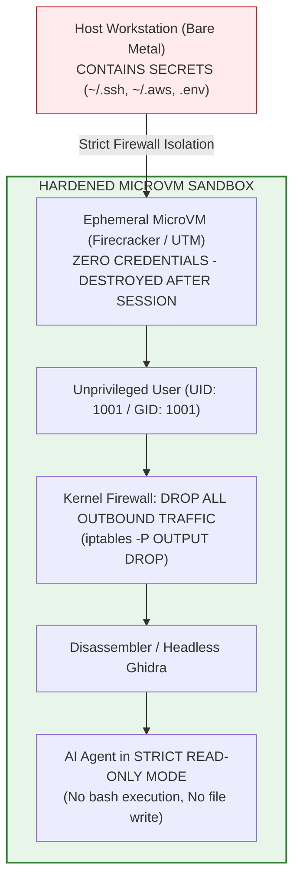

# 07 - The Zero-Trust Developer Safety Blueprint

## 1. The Core Principle: Never Analyze on Bare-Metal

If a cybersecurity researcher, software architect, or developer has legitimate authorization to analyze software for security auditing, malware defense, or interoperability, **the analysis must NEVER occur directly on a primary personal or corporate workstation**.



---

## 2. Hardened Docker Isolation Recipe

If a microVM is unavailable, a strictly hardened, ephemeral Docker container must be utilized. 
**Never run `docker run` with host directory mounts (`-v $HOME:/root`).**

### 2.1 Hardened `Dockerfile`:
```dockerfile
# syntax=docker/dockerfile:1.4
FROM debian:bookworm-slim

# Create unprivileged analysis user
RUN groupadd -g 1001 analyst && \
    useradd -u 1001 -g analyst -m -s /bin/bash analyst

# Install minimal analysis tools
RUN apt-get update && apt-get install -y --no-install-recommends \
    openjdk-17-jre-headless \
    nodejs \
    npm \
    binutils \
    iptables \
    ca-certificates \
    && rm -rf /var/lib/apt/lists/*

USER analyst
WORKDIR /workspace

# Set read-only environment defaults
ENV NODE_ENV=production
ENV HOME=/workspace
```

### 2.2 Secure Container Invocation Command:
```bash
docker run --rm -it \
  --name rea-hardened-sandbox \
  --cap-drop=ALL \
  --security-opt=no-new-privileges:true \
  --memory=4g \
  --cpus=2.0 \
  --pids-limit=100 \
  --read-only \
  --tmpfs /workspace:rw,noexec,nosuid,size=512m \
  --tmpfs /tmp:rw,noexec,nosuid,size=256m \
  --network none \
  rea-sandbox:latest
```

#### Security Directives Explained:
1. `--cap-drop=ALL`: Strips all Linux root capabilities (raw sockets, ptrace, system time alteration).
2. `--security-opt=no-new-privileges:true`: Prevents `setuid` binaries from escalating privileges.
3. `--network none`: **Completely severs all network interfaces.** Zero inbound, zero outbound internet connectivity. Even if an indirect prompt injection payload triggers `curl`, the system call fails instantly.
4. `--read-only`: The container’s root filesystem is mounted read-only, preventing persistence.
5. `--tmpfs /workspace`: Analysis artifacts are stored purely in RAM; exiting the container erases all traces.

---

## 3. Kernel-Level Network Egress Blocking

If running within a dedicated virtual machine, enforce strict kernel-level egress blocking via `iptables`:

```bash
#!/bin/bash
# Enable strict egress isolation for reverse-engineering environments

# 1. Flush existing rules
sudo iptables -F
sudo iptables -X

# 2. Set default policies to DROP
sudo iptables -P INPUT DROP
sudo iptables -P FORWARD DROP
sudo iptables -P OUTPUT DROP

# 3. Allow loopback interface ONLY (Required for local MCP IPC)
sudo iptables -A INPUT -i lo -j ACCEPT
sudo iptables -A OUTPUT -o lo -j ACCEPT

# 4. Explicitly log any dropped outbound connection attempts (Telemetry)
sudo iptables -A OUTPUT -m limit --limit 5/min -j LOG --log-prefix "EGRESS_BLOCK_ATTEMPT: " --log-level 4

echo "Kernel network egress firewall active. Outbound internet severed."
```

---

## 4. The 5 Immutable Rules of AI-Assisted Engineering

1. **Rule of Machine Cleanliness:** Never perform binary reverse-engineering on a workstation containing personal credentials, SSH keys, cloud profiles, or commercial codebases.
2. **Rule of Prompt Boundary Skepticism:** Treat every byte extracted from a compiled binary as an active adversarial input. Never pipe un-sanitized string pools directly into an LLM context.
3. **Rule of Tool Permission Lockdown:** Never execute AI coding agents with flags that bypass human confirmation (such as `--dangerously-skip-permissions` or unattended auto-execution).
4. **Rule of Shannon Entropy Pre-Gating:** Pre-screen binary sections with an entropy scanner; automatically quarantine any section where $H(X) \ge 7.2$ bits/byte.
5. **Rule of Genuine Clean-Room Isolation:** If performing interoperability research, strictly enforce a two-agent architecture: Agent 1 extracts functional interface specifications (text only); an air-gapped Agent 2 implements the code without ever seeing the disassembled binary.
